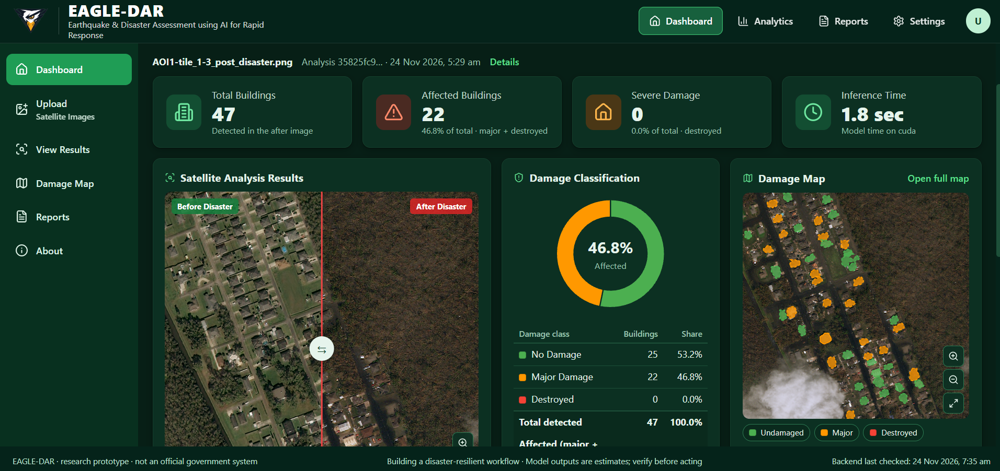

<p align="center">
  
</p>

<h1 align="center">EAGLE-DAR</h1>

<p align="center"><b>Evidence-Aware Geospatial Learning and Explanation for Disaster Assessment and Reasoning</b><br>
Earthquake &amp; Disaster Assessment using AI for Rapid Response</p>

<p align="center">
  
</p>
<p align="center"><i>The dashboard after one analysis: KPI cards, before/after comparison slider, damage classification and the colour-coded damage map.</i></p>

Upload a before and an after satellite image of a disaster area. EAGLE-DAR finds every building, grades its damage in
three classes (no damage, major damage, destroyed) with a per-building confidence, answers PS-04 style counting/comparison questions with evidence regions,
draws a colour-coded damage map, and writes a detailed PDF assessment report with images.

> Research prototype. Results are model estimates that need field verification. It is not an official government system.
> Read [docs/EVALUATION_REPORT.md](docs/EVALUATION_REPORT.md) before trusting any number: the current models are weak
> (see "Honest status" below).

## Features

* **Building detection:** YOLOv8 segmentation finds every building footprint in the after image.
* **Damage grading:** a Siamese ResNet18 compares each building's before and after crop and assigns one of three classes.
* **Building-level confidence:** every building gets a confidence score (detection score x damage probability) rated high / medium / low.
* **Damage map:** colour-coded polygons over the after image, with an interactive zoomable viewer and a before/after slider.
* **Question answering:** PS-04 style counting and comparison questions ("how many destroyed buildings in the top-right quadrant?", "is the left half more damaged than the right half?") answered by deterministic code, each with an evidence region. Questions that cannot be answered from the images return "cannot be determined".
* **PDF assessment report:** executive summary, class tables, spatial breakdown, evidence crops, measured model limitations and recommendations.
* **Dashboard:** upload, results table with a building inspector, analytics charts, damage map page, reports page.

### Damage classes

| Class | Colour | Meaning |
|---|---|---|
| No damage | green | no visible damage in the after image |
| Major damage | orange | visible structural damage (minor and major damage are reported together) |
| Destroyed | red | collapsed, burnt or no longer standing |

**Affected / damaged = major damage + destroyed.** The trained classifier still has five outputs; the pipeline ignores
its "un-classified" output and adds its "minor damage" probability to "major damage" (`collapse_probs` in
`inference/pipeline.py`). Questions that name minor damage or un-classified buildings answer "cannot be determined".

## The three project novelties

| # | Novelty | Where |
|---|---|---|
| 1 | **Building-level confidence score** for every building | `inference/pipeline.py`, building table/inspector/analytics, report section 9 |
| 2 | **Three-class colour-coded damage map** (green, orange, red) | `reasoning/damage_map.py`, interactive map page, PDF section 6 |
| 3 | **Detailed AI-generated disaster assessment report with images** (PDF) | `backend/services/pdf_report.py`, `report_jobs.py`, Reports page |

## Pipeline

```
Before + After image ──► validation ──► alignment check ──► YOLOv8-seg building polygons (after image)
        ──► matched before/after crops ──► Siamese ResNet18 prediction (minor merged into major, un-classified ignored) + building confidence
        ──► deterministic spatial reasoning (PS-04 rules) ──► evidence regions
        ──► damage map │ question answering ──► PDF report (computed facts + template/LLM wording) ──► React dashboard
```

One analysis ID ties every output together. Inference runs once, at upload; pages, refreshes, maps, exports and reports only
read the stored predictions.

## Run it

Python 3.11 (the interpreter that has ultralytics, torch+CUDA, FastAPI, ReportLab), Node 20+.

```powershell
# one-time
python -m pip install -r requirements.txt -r backend/requirements.txt
cd frontend; npm install; cd ..

# backend  -> http://127.0.0.1:8000   (Swagger: /docs)
python -m uvicorn backend.main:app --host 127.0.0.1 --port 8000

# frontend -> http://localhost:5173
cd frontend; npm run dev
```

Or `scripts\start.ps1` to open both in separate windows. Then follow [docs/DEMO_SCRIPT.md](docs/DEMO_SCRIPT.md).

### Tests

```powershell
python -m pytest tests -q            # reasoning, PS-04 oracle, backend API, PDF reports (real models + images)
cd frontend; npm test                # unit tests
npm run e2e                          # real-browser end-to-end test (needs both servers running and Chrome/Edge)
```

### Configuration (environment variables, all optional)

| Variable | Default | Meaning |
|---|---|---|
| `EAGLE_DEVICE` | `auto` | `auto`, `cpu`, `cuda` (CPU fallback is automatic) |
| `EAGLE_STORAGE_DIR` / `EAGLE_REPORTS_DIR` | `outputs/analyses` / `outputs/reports` | where analyses and PDFs are stored (git-ignored) |
| `EAGLE_MAX_UPLOAD_MB`, `EAGLE_MAX_PIXELS`, `EAGLE_MAX_PENDING` | 25, 16.7 M, 4 | upload and queue limits |
| `EAGLE_LLM_ENABLED` | `0` | `1` lets an LLM rephrase the report's explanation text (needs `ANTHROPIC_API_KEY`). Off by default; if on, only aggregate counts and IDs are sent, never images, file names or location labels; text containing any number not in the facts is rejected and the template is used |
| `VITE_API_BASE_URL` (frontend) | `http://127.0.0.1:8000` | backend address |

## API

Interactive docs at `http://127.0.0.1:8000/docs` once the backend is running.

| Method | Endpoint | Purpose |
|---|---|---|
| `GET` | `/api/health` | backend status, model availability, CUDA |
| `POST` | `/api/analyze` | upload before + after image, run the pipeline, returns an analysis ID |
| `GET` | `/api/analysis/{id}` | stored buildings, counts, statistics |
| `GET` | `/api/analysis/{id}/map` | colour-coded damage map (PNG) |
| `POST` | `/api/questions` | answer PS-04 style questions for an analysis |
| `GET` | `/api/analysis/{id}/export` | official-format answers (`id`, `answer`, `region`) |
| `POST` | `/api/analysis/{id}/reports` | start PDF report generation |
| `GET` | `/api/reports/{report_id}/download` | download the PDF |

Full details: [docs/PHASE3_BACKEND_API.md](docs/PHASE3_BACKEND_API.md).

## Tech stack

Python 3.11, PyTorch, Ultralytics YOLOv8-seg, torchvision (ResNet18), OpenCV, Shapely, FastAPI, ReportLab;
React, TypeScript, Vite, Recharts; pytest, Vitest and a Playwright-driven end-to-end test.

## Documentation

| Document | Content |
|---|---|
| [docs/DEMO_SCRIPT.md](docs/DEMO_SCRIPT.md) | 17-step hackathon demonstration and talk track |
| [docs/EVALUATION_REPORT.md](docs/EVALUATION_REPORT.md) | model metrics, confusion matrix, class imbalance, data-split caveats |
| [docs/PERFORMANCE_REPORT.md](docs/PERFORMANCE_REPORT.md) | measured latency, GPU memory, concurrency, CPU fallback |
| [docs/FINAL_TEST_REPORT.md](docs/FINAL_TEST_REPORT.md) | what was tested, results, security checks, gaps |
| [docs/PHASE2_SPATIAL_RULES.md](docs/PHASE2_SPATIAL_RULES.md) | PS-04 spatial rules, conventions taken from the official practice answers, open discrepancies |
| [docs/PHASE3_BACKEND_API.md](docs/PHASE3_BACKEND_API.md) | REST API, errors, security, performance |
| [docs/PHASE4_FRONTEND.md](docs/PHASE4_FRONTEND.md) | frontend pages and decisions |

## Layout

```
backend/     FastAPI app (routes, services, schemas, utils)      inference/   YOLO + Siamese pipeline (Phase 1)
reasoning/   deterministic PS-04 spatial engine, map, facts      evaluation/  metric, benchmark and report scripts
frontend/    React + TypeScript dashboard, e2e test              training/    model definitions and training scripts
tests/       Python test suite                                   docs/        documentation
```

## Honest status

* Measured on held-out validation data: the building detector's mask recall is about 0.21 and the damage classifier's
  macro F1 is about 0.32 at model level; it never predicted minor damage, which is why minor is now merged into major damage. Counts are therefore under-estimates and damage classes are skewed.
  Retraining/improving the models would be the highest-value next step and has **not** been done (no retraining without approval).
* The PS-04 86 % answer-accuracy target is **not** claimed. On the 50 official practice questions the platform answers
  16 with predicted buildings and 47 with ground-truth buildings; the gap is the models, not the reasoning engine.
* Confidence scores are uncalibrated model scores, not probabilities of being correct.
* No geographic coordinates exist in the images, so no district, area or GeoJSON is produced; location labels are what the user typed.
* There is no authentication. The raw dataset in `dataset_source/` is tracked in Git (committed before this work); it is
  CC BY-NC-SA data, so keep the repository private or remove it from history before publishing.

## Data and licence

Imagery and labels: xBD / xView2 (Gupta et al., 2019; Maxar Open Data), CC BY-NC-SA 4.0, used for the PS-04 event and non-commercial work with attribution.
