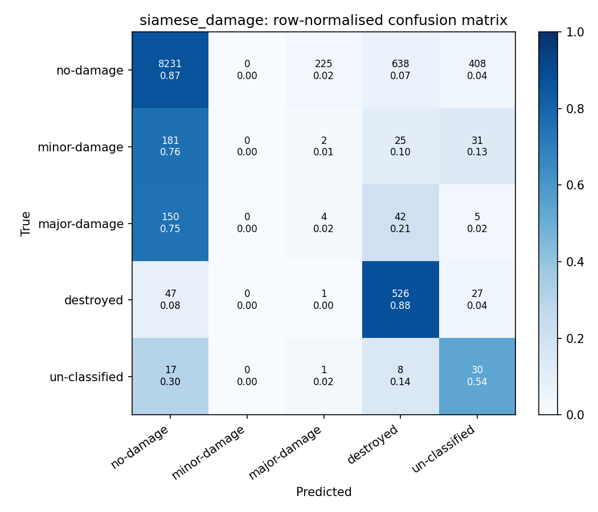

# EAGLE-DAR model evaluation report

Generated by `python -m evaluation.make_evaluation_report` from the evaluation output files. No model was retrained and no weights were changed. Nothing here is an official PS-04 score.

## 1. Which data each number comes from

| Split | Used for | Siamese building pairs | Scenes |
|---|---|---|---|
| Training | weight updates (Siamese) | 26,014 | 289 |
| Validation | monitoring and **choosing the saved checkpoint** (lowest validation loss) | 10,599 | 73 |

* **There is no independent test set.** The validation numbers below were also used to pick the checkpoint, so they are slightly optimistic. They are not training-set numbers.
* The YOLO validation split (80 images, split by scene with a different random split) and the Siamese validation split are **different**: 55 of the 80 YOLO-validation scenes were Siamese *training* scenes. Whole-pipeline numbers therefore use only the scenes that are validation for **both** models (`joint_val`, 20 scenes) and the 40 PS-04 practice pairs, which neither model trained on.
* The hidden PS-04 test data is not available, so the 86 % answer-accuracy target has **not** been evaluated and is not claimed.

## 2. Building detector (YOLOv8-seg), validation split

| Metric | Boxes | Masks |
|---|---|---|
| Precision | 0.382 | 0.349 |
| Recall | 0.240 | 0.214 |
| mAP50 | 0.186 | 0.155 |
| mAP50-95 | 0.056 | 0.042 |

Weights: `best.pt` from the run `eagle_buildings-2`; saved at epoch index 12 of a run configured for 30 epochs (the run stopped early, at epoch 16). The model is weak: it finds roughly one building in five (mask recall), so building counts are strong under-estimates.

## 3. Damage classifier (Siamese ResNet18), validation split

Checkpoint `siamese_damage.pth`, 10,599 validation building pairs.

| Class | Precision | Recall | F1 | Support |
|---|---|---|---|---|
| no-damage | 0.954 | 0.866 | 0.908 | 9502 |
| minor-damage | 0.000 | 0.000 | 0.000 | 239 |
| major-damage | 0.017 | 0.020 | 0.018 | 201 |
| destroyed | 0.425 | 0.875 | 0.572 | 601 |
| un-classified | 0.060 | 0.536 | 0.108 | 56 |

| Overall | Value |
|---|---|
| Accuracy | 0.8294 |
| Macro F1 (5 classes) | 0.3212 |
| Macro F1 excluding un-classified | 0.3746 |
| Macro F1 on minor/major/destroyed only | 0.1967 |
| Weighted F1 | 0.8474 |
| Validation loss (class-weighted CE / unweighted CE) | 0.8054 / 0.5013 |

### Confusion matrix (rows = true class, columns = predicted)

| true \ pred | no-damage | minor-damage | major-damage | destroyed | un-classified |
|---|---|---|---|---|---|
| no-damage | 8231 | 0 | 225 | 638 | 408 |
| minor-damage | 181 | 0 | 2 | 25 | 31 |
| major-damage | 150 | 0 | 4 | 42 | 5 |
| destroyed | 47 | 0 | 1 | 526 | 27 |
| un-classified | 17 | 0 | 1 | 8 | 30 |

### What the numbers mean

* **Accuracy (0.829) is below the majority-class baseline (0.896)**: always answering "no-damage" would score higher. Accuracy is not a useful summary here; macro F1 is.
* The model **never predicts minor damage** (0 predictions; recall 0.00) and almost never major damage (recall 0.02). It over-predicts *destroyed* (1239 predicted vs 601 true; precision 0.42).
* Practical consequence: reports and maps under-report minor and major damage and over-report destroyed buildings; 'damaged' counts are dominated by the destroyed class.

### Class imbalance

| Class | Training pairs | Training share | Validation pairs | Validation share |
|---|---|---|---|---|
| no-damage | 21,736 | 83.6% | 9,502 | 89.6% |
| minor-damage | 821 | 3.2% | 239 | 2.3% |
| major-damage | 1,506 | 5.8% | 201 | 1.9% |
| destroyed | 1,477 | 5.7% | 601 | 5.7% |
| un-classified | 474 | 1.8% | 56 | 0.5% |

The training loss used square-root inverse-frequency class weights, which was not enough to make the rare classes learnable. Likely remedies (not done, as retraining needs approval): stronger class weighting or focal loss, oversampling the three damage classes, label-smoothing/ordinal loss, augmentation, and more epochs with early stopping on macro F1. The un-classified class has only 56 validation examples, so its metrics are very noisy.

## 4. Whole pipeline against ground-truth building polygons (IoU >= 0.5)

| Set | Alignment mode | Scenes | Det. precision | Det. recall | Det. F1 | Matched buildings | Damage acc. (matched) | Damage macro F1 (matched) |
|---|---|---|---|---|---|---|---|---|
| PS-04 practice (40 pairs, never trained on) | check | 40 | 0.549 | 0.117 | 0.193 | 460 | 0.865 | 0.218 |
| PS-04 practice (40 pairs, never trained on) | register | 40 | 0.549 | 0.117 | 0.193 | 460 | 0.872 | 0.226 |
| joint validation (20 scenes, validation for both models) | check | 20 | 0.559 | 0.087 | 0.150 | 376 | 0.830 | 0.232 |
| joint validation (20 scenes, validation for both models) | register | 20 | 0.559 | 0.087 | 0.150 | 376 | 0.832 | 0.220 |

Detection recall is the limiting factor: the pipeline sees a small fraction of the true buildings. Damage metrics are computed only on buildings that were matched, and for the practice set almost all matched buildings are no-damage, so macro F1 there reflects almost no damaged examples.

## 5. PS-04 question answering (practice set, official key)

| Buildings come from | Type 1 (count) | Type 2 (quadrant) | Type 3 (halves) | Type 4 (unanswerable) | All |
|---|---|---|---|---|---|
| Ground-truth buildings (tests the reasoning logic only) | 19/20 | 10/10 | 10/10 | 8/10 | 47/50 (94%) |
| Trained models' predicted buildings (end to end) | 2/20 | 1/10 | 4/10 | 9/10 | 16/50 (32%) |

Answer matches only: the scoring rule for evidence regions is unknown. With ground-truth buildings the three differences are unexplained discrepancies in the official key (documented in `docs/PHASE2_SPATIAL_RULES.md` and pinned in the tests). The large drop with predicted buildings is the building detector and classifier, not the reasoning engine. This is a practice-set measurement, not the hidden test, and **the 86 % target is not claimed**.

## 6. Limitations of this evaluation

* No independent test set; validation was used for checkpoint selection.
* Few scenes (73 Siamese validation scenes, 80 YOLO validation images, 20 joint-validation scenes, 30 practice scenes): confidence intervals are wide.
* Un-classified has 56 validation examples.
* The 86 % PS-04 target is not evaluated or claimed.
